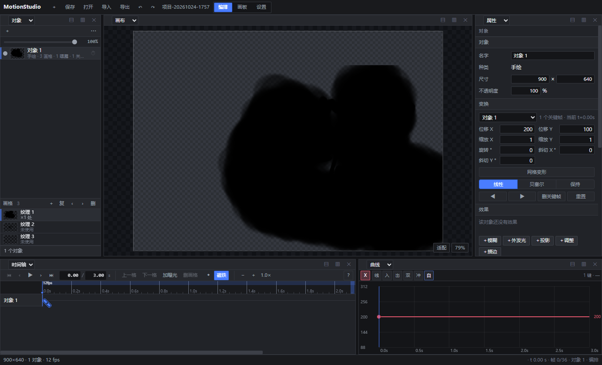
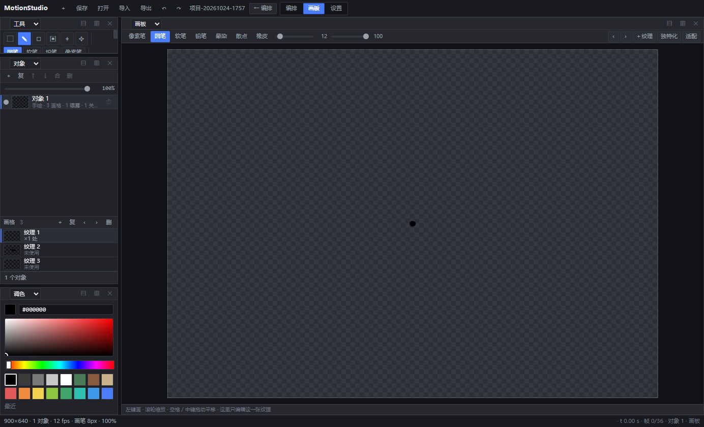
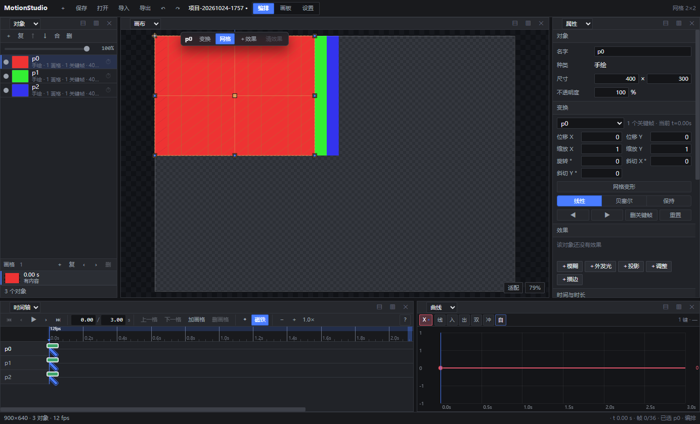

# MotionStudio

**A time-driven 2D character & effects animation tool.** There are no frames — only seconds and keyframes. Artwork lives on keyframes, the timeline is a continuous second axis, and the paint board edits exactly one texture at a time.

[English](README.md) · [简体中文](README.zh-Hans.md)

[](LICENSE)
[](package.json)
[](#design-principles)



---

## What it is for

MotionStudio targets **2D game art and short motion design**, not post-production:

- **Indie game artists** — character idle / attack / hit cycles, exported as frame sequences or spritesheets for the engine.
- **Frontend & motion designers** — illustration-style motion, interface demos, exported as WebM.
- **Content authors** — stickers and short transparent loops.

It does **not** aim at film/TV compositing, 3D, skeletal formats from other tools (Spine / DragonBones import), or frame-by-frame pixel-art painting — Aseprite owns that niche.

**Rigging (bones) is in progress.** Three of four stages have shipped. Stage 1 (bone objects) landed in `0.5.0-alpha.20`: a bone is an ordinary object with `kind: 'bone'`, so it rides the existing parent chain, per-object time channels and keyframes — you can already build a hierarchy and animate it. Stage 2a (mesh skinning) landed in `0.5.0-alpha.21`: linear-blend skinning as a pure evaluator seam. Stage 2b (binding) landed in `0.5.0-alpha.22`: select a texture layer plus the bones, run **Bind to selected bones**, and the texture follows them — weights are computed automatically (nearest bones, inverse-square falloff), and a skin parented to a bone is refused both when you bind and when you drag. Stage 2c (weight painting by hand) landed in `0.5.0-alpha.25`: turn on **Edit weights** in the properties panel, pick a target bone, then drag across the mesh vertices — one stroke is one undo step and `Esc` rolls it back. That completes stage 2. Stage 3 (IK) landed in `0.5.0-alpha.29`: a bone can carry an `ik` constraint that aims a chain of up to 8 bones at **another ordinary object** — so the target can be keyframed with the channels you already have. The solve only feeds the render matrices and never writes back to keyframes. Two-bone chains are solved analytically (exact hit) and accept an explicit **elbow side**; longer chains use CCD. There is no pole vector (2D has no bending plane — the elbow side is what a pole vector would control). Stage 4 (engine interop) remains. Full staged plan and the exact seams: [docs/骨骼动画方案-2026-11-02.md](docs/骨骼动画方案-2026-11-02.md) *(Chinese)*.

## Why "time-driven"

In frame-based software, time is "cell N". Here time is a continuous seconds axis:

| | Frame-based | MotionStudio |
| --- | --- | --- |
| Content belongs to | frame N | **a point in seconds** (`key.drawing` points at a texture) |
| Gap between two drawings | hold / copy / mark cells | **natural continuation** — the last drawing stays until the next one appears |
| Changing artwork | replace the frame | **one keyframe operation** |
| Frame rate | one global number | **segmented** (VFR — every segment may run at its own fps) |

The payoff is direct: paint one drawing at 0.2s and the next at 3s without inserting anything in between; one texture can be reused at many moments through a single keyframe track; export re-samples at the per-segment frame rate instead of being locked to a grid.

## Features

**Painting**
- Seven brushes — pixel / round / soft / pencil / smudge / scatter / eraser — with hardness, spacing, jitter and flow
- Tablet pressure with a response curve; very short strokes skip pressure
- Six stabilizer levels (`Ctrl+wheel` on the paint board), each reporting measured stroke bbox / corner count / second difference
- The paint board has its own camera, zoom / pan, mirror, color picker, palette, undo-redo
- Three ways to pick a color: the `E` picker, **right-drag**, and `Alt+Left` — the last two are temporary tools that return to the previous brush on release and never touch the undo stack
- Bucket fill (`G`): contiguous same-color region, tolerance 24, four-neighborhood; imported bitmaps are refused with a clear message

**Animation**
- Keyframes: linear / bezier (draggable handles) / hold; `Shift`-drag = free drag that ignores the magnet
- Curve editor: one channel per animated quantity — position, scale, rotate, skew, opacity, lattice vertices, effect parameters — with a per-channel vertical range; channels can be multi-selected as reference lines and folded into a compact "N selected" summary
- Every object carries a **time channel** (offset / scale / hold), so the same keyframes can run at different rhythms
- Onion skin (N before / after, stepping on *texture change points*, not on equal frame steps)
- Segmented variable frame rate; the colored strip under the timeline is the fps segmentation
- Timeline `Ctrl+wheel` zooms anchored at the pointer; **double-click the ruler = fit the whole duration**; the toolbar degrades by width instead of clipping labels

**Textures**
- An object owns a **texture library**; a keyframe's `drawing` id picks which texture shows from that moment on (`null` = explicit blank), so one texture can be reused at many moments
- The properties panel has a **texture drawer**: one row per texture — thumbnail, size, exposure times or *Unused*, current one highlighted. Click a row to place that texture at the playhead (one undo step), delete a row with a two-click confirm; unused textures stay in the library and are saved with the project

**Objects**
- Transform: position / scale / rotate / skew / opacity
- Parenting, blend modes, clipping masks
- Lattice warp with keyframeable vertices
- Five **render-time** effects — blur / glow / shadow / adjust (brightness·contrast·saturation·hue) / outline — never baked into the bitmap; parameters are keyframeable and share the same easing evaluator

**Import / export**
- Import: PSD / PSB (zero-dependency parser; keeps layers, visibility, opacity, blend mode, parent groups), PNG / JPG / WebP
- Save: project library (IndexedDB, silent autosave) **and** `.msp` project files (JSON, bitmaps inlined) — the two coexist. Once a project is bound to a file, `Ctrl+S` writes the library **and** writes that same serialization back to the file; **Save as…** writes a new `.msp` and rebinds; **Unbind file…** (only visible while a file is bound) stops the write-back without deleting anything; a failed write-back is reported ("library saved, project file not updated"), never silently reported as success
- Project library management: cards show texture count, size, object count, last-opened time and the bound file; **Duplicate** forks a project inside the library (the copy gets a new id and is not bound to the original file); **Export the whole library…** packs every project into one `.json` backup, and **Import project file** restores it (single `.msp` files work as before). The list sorts by last save / last open / name / size (remembered), cards can be **pinned** to the top, and **tags** can be added for filtering; the header shows the library's total size. Binding one `.msp` to a second project asks before moving the binding, and an unexpected takeover at open time is reported. Every save keeps a **version snapshot** (up to 10 per project): the card's **History** action lists them and restores any of them — the current state is snapshotted first, so a restore is itself undoable
- Export: PNG sequence, spritesheet + coordinate JSON (own format, **Phaser 3** and **Aseprite / TexturePacker / Godot / Love2D / Unity** frame tables), **animated GIF** and **APNG** (zero-dependency encoders; APNG keeps full colour and 8-bit alpha), WebM (VP9)

## Running it

This repository is the **core** (renderer + tests + docs + quality gates). It runs as a plain static site; the Electron desktop shell lives in a separate repository.

### Browser (this repository)

`app/` **is** the site: zero build step, zero third-party runtime dependencies.

```bash
git clone https://github.com/Satyr-Astry/motionstudio.git
cd motionstudio
npm run serve        # node tools-serve.mjs → http://127.0.0.1:43117
```

Or point any static server at `app/` (`.mjs` must be served as JavaScript; `file://` will not work because of module CORS). See [Browser](#browser) for the three requirements.

### Desktop (separate repository)

The Electron shell — native file dialogs, exact-path export, NSIS packaging — is [`motionstudio-desktop`](https://github.com/Satyr-Astry/motionstudio-desktop), which mounts this repository at `core/` as a git submodule:

```bash
git clone --recursive https://github.com/Satyr-Astry/motionstudio-desktop.git
cd motionstudio-desktop
npm install
npm start
```

Postinstall does not always run (npm 11+); if `core/` is empty run `git submodule update --init --recursive`. Desktop releases are published from that repository.

### Browser

`app/` **is** a plain static site: the renderer uses only relative ES module imports — no bare specifiers, no `node:` imports, no bundles, no `http://` references. Serve the folder over http(s) (`.mjs` must be served as JavaScript; `file://` will not work because of module CORS) and it loads.

Exactly one module touches desktop capability — [app/shell/ipc.mjs](app/shell/ipc.mjs), whose `bridge()` reads `globalThis.window.motionAPI` (`app/shell/ipc.mjs:51-52`). Without the shell, the calls in `project-io.mjs` / `import-file.mjs` would lose the native file dialogs and exact-path export — so the **web bridge** replaces them: [`app/shell/bridge-web.mjs`](app/shell/bridge-web.mjs) installs six browser implementations (`input[type=file]` for open/import, `a[download]` for export/save) through `ipc.setBridge()`, and `app/index.html` loads it before `app.mjs`. A browser session therefore **draws, animates, plays, imports and exports for real** — what it cannot do is pick a folder (`openFolder` reports that instead of pretending) or overwrite a bound project file in place (`saveProjectTo` returns a structured `unsupported` instead of a fake success), and exports land in the download folder. Forget a step and the failure is reported as a failure: `alpha.16` removed every path that used to say "done" without writing a file.

### Repository split

This repository is the **core**: the renderer (`app/`), tests, docs and the quality gates. The desktop **shell** (`main.js`, `preload.js`, IPC, Electron packaging) lives in [`motionstudio-desktop`](https://github.com/Satyr-Astry/motionstudio-desktop) and mounts this repository at `core/` as a git submodule. The contract between the two halves is the eight IPC channel names — see [Core concepts](#core-concepts); the desktop repository's `test/channels.test.mjs` pins it in both directions. Desktop releases are published from the shell repository; the web build is this repository deployed as a static site.

## Three workspaces

| Workspace | Does exactly one thing | Contents |
| --- | --- | --- |
| **Compose** | arrange time, watch the composite | layers / stage / properties / timeline / curves |
| **Paint** | edit *this one texture* | its own canvas and camera, brushes, stabilizer, size, opacity, color picking, mirror, undo |
| **Settings** | everything not about drawing | document / onion skin / preferences / info / help |

The paint board has its own canvas and camera — that is the precondition for "the brush never lands anywhere else". `Esc` returns to compose from anywhere.

| Paint board | Lattice warp + keyframes |
| --- | --- |
|  |  |

## Core concepts

- **Texture** — an object's artwork. One object owns a library of textures; each may be reused at many moments.
- **Drawing / exposure** — a keyframe's `drawing` id selects which texture shows from that moment on. `null` is an explicit blank; a missing field inherits the previous one.
- **Keyframe** — `{ t, state, ease, h1, h2, drawing }`.
- **Channel** — one track per animatable quantity, each with its own easing. Effect parameters are channels too (`fx.<effectId>.<param>`).
- **IPC bridge** — the eight channels the renderer may call: `exportFrames`, `exportSheet`, `saveProject`, `saveProjectTo` (write back without a dialog), `loadProject`, `saveBinary`, `importFile`, `openFolder`. The function name in `ipc.mjs`, the method name in `preload.js` and the channel string in `main.js` must stay identical; the desktop shell repository's `test/channels.test.mjs` pins that contract against this repository's `app/shell/ipc.mjs`.

## Shortcuts

`Ctrl+Shift+P` command palette · `?` shortcut sheet · `Esc` cancel / close / back to compose

| Action | Key | Action | Key |
| --- | --- | --- | --- |
| Save project | `Ctrl+S` | Project library | `Ctrl+O` |
| Export frame sequence | `Ctrl+Shift+E` | Undo / redo | `Ctrl+Z` / `Ctrl+Shift+Z` |
| Copy / paste keyframes | `Ctrl+C` / `Ctrl+V` | Delete selected object | `Del` (two-step confirm) |
| Play / pause | `Space` | Go to start / end | `Home` / `End` |
| Step one frame (1/fps) | `←` / `→` | Previous / next keyframe | `,` / `.` |
| Previous / next exposure | `Shift+,` / `Shift+.` | Fit view | `0` |
| Smaller / larger brush | `[` / `]` | Timeline zoom at pointer | `Ctrl+wheel` |
| Pick color (temporary) | right-drag / `Alt+Left` | Stabilizer level | `Ctrl+wheel` (paint board) |

## Project file (`.msp`)

A single JSON file, `version: 4`. Bitmaps are inlined as data URLs; each bitmap is encoded once:

```jsonc
{ "format": "motionstudio-project", "version": 4, "name": "…", "savedAt": 1750000000000,
  "width": 900, "height": 640, "fps": 12, "loopMode": "loop", "duration": 3,
  "elements": [ { "id": "obj-1", "name": "Object 1", "kind": "paint",
                  "mixMode": "source-over", "opacity": 1, "effects": [],
                  "drawings": [ { "ref": "obj-1",   "w": 900, "h": 640 },   // texture library (source of truth)
                                { "ref": "obj-1#2", "w": 900, "h": 640 } ],
                  "cels":     [ { "at": 0,    "image": { "ref": "obj-1",   "w": 900, "h": 640 } },
                                { "at": 1.25, "image": null } ],   // projection cache, recomputed from drawings + keys
                  "transform": { "keys": [ /* t / state / ease / h1 / h2 / drawing */ ] } } ],
  "assets":   { "obj-1": "data:image/png;base64,…",     // key = object id, #2 = that object's 2nd bitmap
                "obj-1#2": "data:image/png;base64,…" },
  "timebase": { "segments": [ /* segmented VFR */ ] },
  "tags": [], "onion": { /* onion skin */ } }
```

The source of truth is `drawings` plus the `drawing` field on keyframes: **a texture belongs to a keyframe**. A keyframe points a moment at one bitmap from the library (`{ "t": 1.25, "drawing": "obj-1#2" }`); `null` is an explicit blank — the exposure exists but is empty. `cels` is a **projection cache** derived from that data, recomputed on save, so hand-editing `cels` has no effect. `assets` is keyed by each drawing's `ref`, so one bitmap is stored once.

Reading accepts v1 / v2 / v3 / v4 and legacy `.json` projects; a file whose `format` is not this app's is rejected outright.

## Repository layout

```
app/                 ← this is the site root (static, no build step)
  core/              pure logic, no DOM: doc-model / cel / transform / evaluator /
                     timegraph / timebase / lattice / element / history / psd
  paint/             drawing & compositing: engine (stage) / stroke / brush /
                     composite / effects / onion / patch (region undo) / surface
  editors/           panels: canvas / board (texture editor) / layers / timeline /
                     curve / palette / properties / projects / help / toolbar
  shell/             shell glue: app (assembly) / view-host (area tree) /
                     doc-state / project-io / project-store / spritesheet /
                     video-plan / ipc (the only bridge to the desktop shell)
  styles/            design tokens and stylesheets
docs/                contracts (CONTRACT-v*.md), ledgers, guides
tests/               node:test unit suites
```

The desktop shell (`main.js`, `preload.js`, packaging) is **not** in this repository — see [motionstudio-desktop](https://github.com/Satyr-Astry/motionstudio-desktop).

## Tests and quality gates

```bash
npm test               # node --test tests/*.test.mjs
npm run check          # static consistency + syntax + layering + i18n report
npm run check:static   # static consistency only (frame-concept leftovers, dead imports, unused imports)
npm run check:syntax   # syntax only (node --check per module, incl. the root tool scripts)
npm run check:layers   # dependency direction inside app/ (core must not import shell/editors, …)
npm run check:docs     # hand-filled baseline numbers (version, batch count, module/test counts) must match the code
npm run smoke          # boots app/ in a shell-less window and mounts every editor
```

`npm test` only imports pure-logic modules — the DOM-facing ones (`app.mjs`, `layers.mjs`, `board.mjs`, …) are never loaded by Node. That gap has produced "all tests green + static check clean + blank page" **four** times in this project's history (a function exported twice, a duplicated import entry, a half-written file, and an i18n helper imported as `tr` while one call site still said `t(...)` — which took out the whole Stack panel). `check:syntax` closes the syntax half of that hole; `npm run smoke` closes the runtime half.

`npm run smoke` serves `app/` from a throwaway HTTP server and loads it in an Electron window **with no preload and no nodeIntegration** — i.e. exactly what a browser gets. It then switches a panel through every editor in the registry and flips the language both ways, collecting any console error along the way. It is also the browser-mode acceptance test: `window.motionAPI` must be absent and the web bridge must be in place.

Current baseline: **1698 tests / 1691 pass / 7 skipped / 0 fail** across 120 test files; static check scans 105 modules with 0 leftovers, 0 broken imports and 0 unused imports; syntax check 109/109 (105 app/ modules + 4 root tool scripts); layering check reports 0 cross-layer imports; i18n check reports 129 strings still outside the dictionary and 0 structural gaps; smoke mounts **15/15** editors with 0 console errors. Run `npm test`, `npm run check` and `npm run smoke` before handing work over.

## Design principles

1. **Single-writer state** — every document change goes through `setDoc(updater)` and produces a new document that is then broadcast; history is funnelled through the paint engine; the command layer touches no DOM and records no history.
2. **No DOM in `core`** — `app/core/*` is pure functions, which is why most test files only exercise it and everything runs under plain Node.
3. **No build step** — native ES modules are loaded by the browser directly; edit a line, reload, see it. There is no compiled artifact that can drift from the source.

## Known limitations

- Only verified on Windows (Electron) so far.
- WebM export uses `MediaRecorder` in **real time**: the window must stay in the foreground while recording, and VP9 alpha is not enabled, so transparent backgrounds come out black.
- GIF has the three limits the format imposes: **transparency is 1-bit** (soft edges become fully opaque or fully clear), **256 colours** (gradients band), and files are much larger than WebM for the same content.
- Curve channels support multi-select and reference lines (and can be folded into a compact "N selected" summary); dragging channels between tracks is not implemented. The texture library has a drawer where clicking a row places that texture at the playhead. PSB smart objects and text layers are not parsed.
- Project files inline bitmaps as data URLs, so projects with hundreds of MB of artwork get noticeably slow.
- Browser mode relies on the web bridge (see [Running it](#running-it)); "pick a folder" has no browser equivalent and exports land in the download folder — use the desktop shell when you need native dialogs and exact paths.

## Docs

> Index of everything: [docs/README.md](docs/README.md) — contracts / ledgers / topic notes, and the rules for adding new docs.

All documents are written in Chinese:

- [使用说明](docs/使用说明.md) — concepts, workspaces, paint board, timeline, export
- [CONTRACT-v8-分区与时间轴](docs/CONTRACT-v8-分区与时间轴.md) — areas, paint-board controls, texture/keyframe contract
- [CONTRACT-v6-时间模型](docs/CONTRACT-v6-时间模型.md) — the "no frames, only time" data model
- [骨骼动画方案](docs/骨骼动画方案-2026-11-02.md) — bone objects, mesh skinning, IK; staged plan and seams
- [修复列表-v8](docs/修复列表-v8.md) — per-issue root cause, fix and real-device verification
- [画板与 Klecks 对照](docs/画板-与klecks对照-2026-10.md) — porting progress, gaps and intentional differences (with Klecks source line refs)
- [宣传片](docs/promo/motionstudio-promo.webm) — 27-second overview (WebM)

## License

[MIT](LICENSE). Brush feel references [Klecks](https://github.com/bitbof/klecks) (MIT); the PSD parser is a zero-dependency implementation of this repository.

Early-stage software: the file format and APIs still move.
