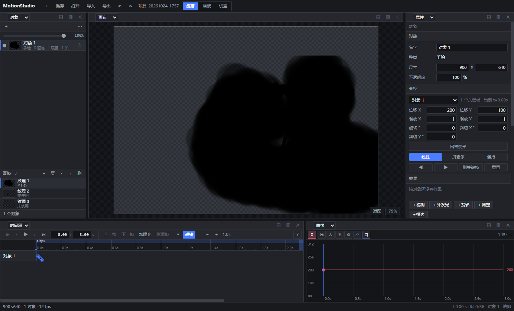
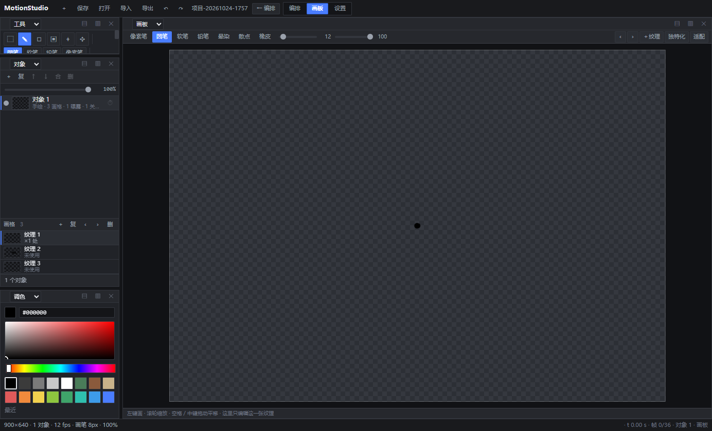
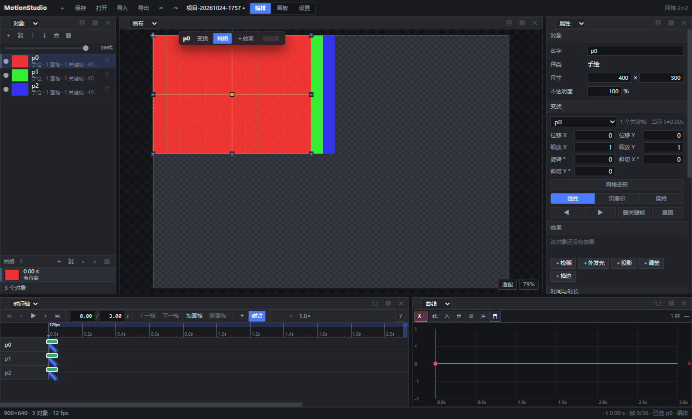

# MotionStudio

**时间驱动的 2D 动画编辑器**：没有「帧」，只有秒与关键帧；画板只编辑一张纹理，编排只管时间与合成。

[](LICENSE)
[](tests)
[](package.json)
[](main.js)



---

## 为什么是「时间驱动」

传统逐帧软件里，时间是「第 N 格」；这里时间是一条连续的秒轴：

| | 逐帧软件 | MotionStudio |
| --- | --- | --- |
| 内容属于 | 第 N 帧 | **某一秒**（`cel = { at, image }`） |
| 两张画之间的间隔 | 靠补帧 / 复制帧 / 标记保持 | **自然延续**，下一张画出现前一直用这一张 |
| 换图 | 换帧内容 | **一次关键帧操作**（`key.drawing` 指向纹理） |
| 帧率 | 全局一个数字 | **按时间分段**（VFR，每段可不同 fps） |

好处很直接：0.2 秒画一张、3 秒后再画一张，中间不用任何补帧操作；同一张纹理能被多个时刻复用，时间轴上只需要一条关键帧轨；导出时按分段帧率重新采样，而不是被「格子」锁死。

## 功能

**绘制**
- 7 种笔刷：像素笔 / 圆笔 / 软笔 / 铅笔 / 晕染 / 散点 / 橡皮，可调硬度、间距、抖动、流量
- 数位板压感 + 压感曲线；短笔画不套压感
- 手抖稳定器 6 档（按钮或 `Ctrl+滚轮` 调档），逐档给出「笔迹包围盒 / 拐点数 / 二阶差分」实测
- 画板自带独立相机、缩放 / 平移、镜像、取色、调色板、撤销重做
- 取色有三条路：`E` 取色器、**右键按住拖动**、`Alt+左键`——后两者是临时工具，松开即回原笔刷，且不写笔刷、不进撤销栈
- 油漆桶（`G`）：同色连通区一次填满，容差 24、四邻域；导入的位图纹理会明确提示不支持（撤销绑纹理引用，换画格后再撤销也不会写错图）

**动画**
- 关键帧：线性 / 贝塞尔（可拖手柄）/ 保持；`Shift` 拖 = 临时自由拖动（忽略磁铁）
- 曲线编辑器：位置 / 缩放 / 旋转 / 斜切 / 不透明度 / 网格顶点 / 效果参数各自一条通道，纵轴按通道语义给范围
- 每个对象自带**时间通道**（偏移 / 缩放 / 保持），同一批关键帧可以走不同节奏
- 洋葱皮（前 N / 后 N 画格，按「画格切换点」而非等距帧）
- 分段帧率（VFR），时间轴底部彩色细条即帧率段
- 时间轴 `Ctrl+滚轮` 以指针时刻为锚缩放、**双击刻度尺 = 适应全长**（整段时长装进视口）；工具条按宽度分级收字并可横滚，1280 以下不会把字切半行

**对象**
- 变换：位置 / 缩放 / 旋转 / 斜切 / 不透明度
- 层级父子、混合模式、裁剪蒙版
- 网格变形（lattice warp），顶点也可打关键帧
- 5 种**渲染期**效果器：模糊 / 外发光 / 投影 / 调整（亮度·对比度·饱和度·色相）/ 描边 —— 不烘焙进位图，参数可打关键帧，走同一套缓动求值

**导入导出**
- 导入：PSD / PSB（零依赖自研解析器，保留图层、可见性、不透明度、混合模式、父组）、PNG / JPG / WebP
- 保存：`.msp` 项目文件（JSON，位图内联；兼容 v1–v3 与旧 `.json`）、项目库（IndexedDB）+ 静默自动保存
- 导出：PNG 序列、精灵图 + 坐标 JSON、WebM 视频（VP9）

## 快速开始

需要 Node 20+（只用它启动 Electron，应用本身零第三方运行时依赖）。

```bash
git clone https://github.com/Satyr-Astry/motionstudio.git
cd motionstudio
npm install        # 只装 Electron 这一个开发依赖
npm start
```

> **npm 11 及以上**默认不执行依赖的 install/postinstall 脚本。如果启动时报
> `Electron failed to install correctly`，补一句 `node node_modules/electron/install.js` 即可；
> 国内网络再加 `ELECTRON_MIRROR=https://npmmirror.com/mirrors/electron/`。
>
> 不装依赖也能跑：`npx --yes electron .`

窗口起来后 Electron 会起一个本机静态服务（默认 43117，被占用则顺延），改完源码按 `Ctrl+R` 重载。

## 三个工作区

| 工作区 | 只做一件事 | 组成 |
| --- | --- | --- |
| **编排** | 排时间、看合成结果 | 对象树 / 舞台 / 属性 / 时间轴 / 曲线 |
| **画板** | 只编辑当前这一张纹理 | 独立画布与相机、笔刷、稳定器、大小、不透明度、取色（`E` / 右键 / `Alt+左键`）、镜像、撤销 |
| **设置** | 与「画」无关的配置 | 文档 / 洋葱皮 / 偏好 / 信息 / 帮助 |

画板是独立的 canvas 与相机，不与舞台共享 —— 这是「笔不会落到别处」的前提。`Esc` 从任意工作区回到编排。

| 画板（纹理编辑器） | 网格变形 + 关键帧 |
| --- | --- |
|  |  |

## 核心概念

- **纹理（texture）**：对象的图。一个对象有一库纹理，可被多个时刻复用。
- **画格（cel）**：`{ at, image }`，即「某一秒有一张图」，一直沿用到下一个画格出现。它不属于某个固定帧率。
- **关键帧（key）**：`{ t, state, ease, h1, h2, drawing }`。`drawing` 表示「这一刻起显示哪张纹理」；`drawing: null` 是显式空白，缺字段表示沿用上一张。
- **通道（channel）**：每条可动画的量一条轨道，独立缓动。效果参数也是通道（如 `fx0.blur.amount`）。

## 快捷键

`Ctrl+Shift+P` 命令面板（30 条命令，分组列出）· `?` 快捷键一览 · `Esc` 取消 / 关闭浮层 / 回到编排

| 动作 | 键 | 动作 | 键 |
| --- | --- | --- | --- |
| 保存项目 | `Ctrl+S` | 打开项目库 | `Ctrl+O` |
| 导出帧序列 | `Ctrl+Shift+E` | 撤销 / 重做 | `Ctrl+Z` / `Ctrl+Shift+Z` |
| 复制 / 粘贴关键帧 | `Ctrl+C` / `Ctrl+V` | 删除选中对象 | `Del`（两段式确认） |
| 播放 / 暂停 | `Space` | 回到开头 / 结尾 | `Home` / `End` |
| 逐帧步进（1/fps） | `←` / `→` | 上/下一个关键帧 | `,` / `.` |
| 上/下一个画格 | `Shift+,` / `Shift+.` | 适配视图 | `0` |
| 笔刷变小 / 变大 | `[` / `]` | 时间轴以指针为锚缩放 | `Ctrl+滚轮` |
| 取色（临时工具，松开即回） | 右键拖 / `Alt+左键` | 稳定器调档 | `Ctrl+滚轮`（画板） |

## 项目文件（`.msp`）

单文件 JSON，当前 `version: 4`，位图内联为 dataURL，同一张位图只编码一次：

```jsonc
{ "format": "motionstudio-project", "version": 4, "name": "…", "savedAt": 1750000000000,
  "width": 900, "height": 640, "fps": 12, "loopMode": "loop", "duration": 3,
  "elements": [ { "id": "obj-1", "name": "对象1", "kind": "paint",
                  "mixMode": "source-over", "opacity": 1, "effects": [],
                  "cels":     [ { "at": 0,    "image": { "ref": "obj-1",   "w": 900, "h": 640 } },
                                { "at": 1.25, "image": null } ],   // null = 显式空白
                  "drawings": [ { "ref": "obj-1#2", "w": 900, "h": 640 } ],  // 画格库
                  "transform": { "keys": [ /* t / state / ease / h1 / h2 */ ] } } ],
  "assets":   { "obj-1": "data:image/png;base64,…",     // key = 对象 id，#2 起是同对象的第 2、3 张
                "obj-1#2": "data:image/png;base64,…" },
  "timebase": { "segments": [ /* 分段帧率 VFR */ ] },
  "tags": [], "onion": { /* 洋葱皮 */ } }
```

`cels` 挂在**每个对象**下（v4 是时间模型：对象自带按秒索引的画格），`assets` 以对象 id 为 key，同一张位图只编码一次。

读入时自动识别 v1 / v2 / v3 / v4 与旧 `.json` 项目；`format` 不是本应用的文件会被直接拒绝。

## 目录结构

```
main.js              主进程：本机静态服务 + 窗口 + 文件对话框 IPC
preload.js           contextBridge 暴露的最小 API
app/
  core/              纯逻辑、零 DOM：doc-model / cel / transform / evaluator /
                     timegraph / timebase / lattice / element / history / psd
  paint/             绘制与合成：engine（舞台）/ stroke / brush / composite /
                     effects / onion / patch（区域撤销）/ surface / thumb
  editors/           面板：canvas / board（纹理编辑器）/ layers / timeline /
                     curve / palette / properties / projects / help / toolbar
  shell/             外壳：app（装配）/ view-host（区域树）/ doc-state /
                     project-io / project-store / spritesheet / video-plan / ipc
  styles/            设计令牌与样式
docs/                契约文档（CONTRACT-v*.md）、修复列表、使用说明
tests/               node:test 单元测试（64 个文件）
```

## 测试

```bash
npm test        # node --test tests/*.test.mjs
npm run check   # 静态一致性（帧概念残留 + 失效 import）+ 语法检查（逐个 node --check）
npm run check:static   # 只跑静态一致性
npm run check:syntax   # 只跑语法检查
```

`npm test` 只 import 纯逻辑模块，DOM 那几个（`app.mjs`、`layers.mjs`、`board.mjs`…）从没被 node 加载过 —— 所以历史上出现过三次「测试全绿 + 静态检查干净 + 页面白屏」（同一函数被 `export` 两次、import 列表写重、文件被写一半）。`check:syntax` 就是补这条缝的：它对 `app/**/*.mjs` 逐个跑 `node --check`，几百毫秒。

当前基线：**985 tests / 983 pass / 2 skipped / 0 fail**；静态检查扫描 77 个模块，残留 0、坏 import 0；语法检查 77/77。改代码后 `npm test` 与 `npm run check` 都跑一遍。

## 设计原则

1. **单写者状态**：所有文档变更走 `setDoc(updater)` 产生新文档再广播；历史由 paint/engine 统一收口，命令层不碰 DOM、不记历史。
2. **core 不依赖 DOM**：`app/core/*` 是纯函数，57 个测试文件里大半只测它，所以能在 Node 里直接跑。
3. **无构建步骤**：原生 ES Module 直接由 Chromium 加载，改一行刷新即见，不存在「编译产物与源码不一致」。

## 已知限制

- 目前只在 Windows（Electron）上验证过。
- WebM 导出用 `MediaRecorder` 按**真实时间**录制，导出时窗口需保持前台；VP9 的 alpha 通道未开，透明背景会变黑底。
- 曲线区与纹理库的多选 / 拖放还在打磨；PSB 的智能对象、文字层不解析。
- 项目文件把位图内联成 dataURL，几百 MB 级素材的项目会明显变慢。

## 文档

> 全部文档的索引：[docs/README.md](docs/README.md)（契约 / 账本 / 专题三类，新增文档的规矩也写在那里）

- [使用说明](docs/使用说明.md) —— 概念、工作区、画板、时间轴、导出
- [CONTRACT-v8-分区与时间轴](docs/CONTRACT-v8-分区与时间轴.md) —— 分区、画板控件、纹理与关键帧契约
- [CONTRACT-v6-时间模型](docs/CONTRACT-v6-时间模型.md) —— 「没有帧，只有时间」的数据模型
- [修复列表-v8](docs/修复列表-v8.md) —— 逐条问题的根因、修法与真机验证
- [画板与 Klecks 对照](docs/画板-与klecks对照-2026-10.md) —— 复刻进度、缺口与有意差异（带 Klecks 源码行号）
- [宣传片](docs/promo/motionstudio-promo.webm) —— 27 秒概览（WebM）

## License

[MIT](LICENSE)。笔刷手感参考 [Klecks](https://github.com/bitbof/klecks)（MIT）；PSD 解析器为本仓库零依赖实现。

---

## English

**MotionStudio** is a time-driven 2D animation editor for Windows: there are no frames, only seconds and keyframes. A drawing is an event at a point in time (`cel = { at, image }`) and stays on screen until the next one; swapping artwork *is* a keyframe. It ships three workspaces — compose / paint / settings — with a Bezier curve editor, per-object time channels, segmented variable frame rate, onion skin, lattice warp, five keyframeable render-time effects, a zero-dependency PSD/PSB importer, and PNG-sequence / spritesheet / WebM export. Electron shell + native ES modules: **no build step, no third-party runtime dependencies**.

```bash
npm install && npm start     # Node 20+; Electron is the only dev dependency
npm test                     # 983 passing / 2 skipped
```

Early-stage software: file format and APIs still move. MIT licensed.
