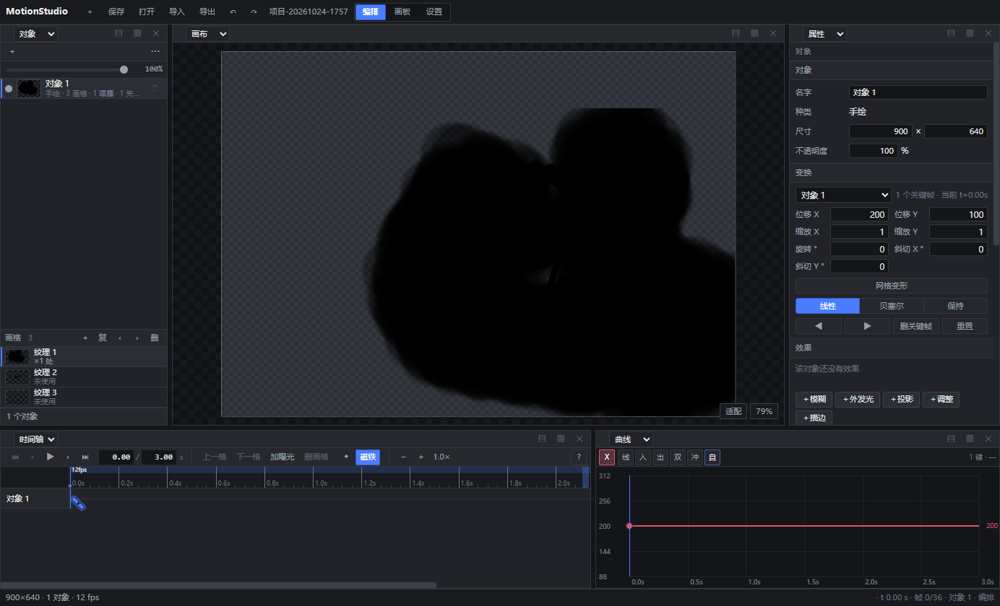
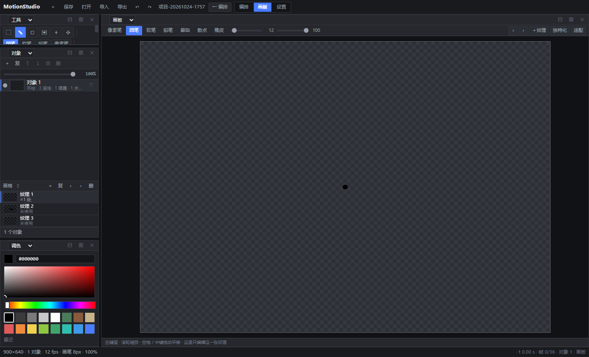
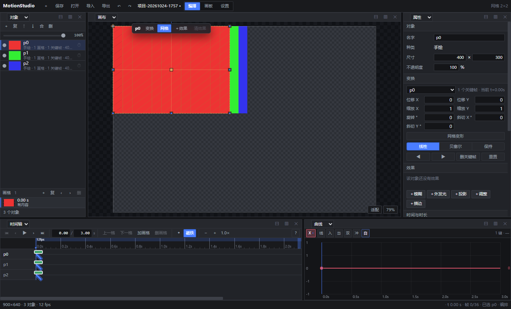

# MotionStudio

**时间驱动的 2D 角色与特效动画工具。** 没有「帧」，只有秒与关键帧；纹理挂在关键帧上，时间轴是一条连续的秒轴，画板一次只编辑一张纹理。

[English](README.md) · [简体中文](README.zh-Hans.md)

[](LICENSE)
[](package.json)
[](#设计原则)



---

## 它服务于谁

MotionStudio 面向**独立游戏的 2D 美术资产**与**短动效**，不做影视后期：

- **独立游戏美术** —— 角色待机 / 攻击 / 受击循环，导出帧序列或精灵图交给引擎。
- **前端与动效设计** —— 插画式动效、界面演示，导出 WebM。
- **内容作者** —— 表情包与透明短动图。

明确**不做**：影视合成、3D、其它工具的骨骼格式（Spine / DragonBones 导入）、逐帧像素手绘（那是 Aseprite 的地盘）。

**骨骼（装配）正在做。** 四个阶段已发三个、第三期进行中。第一期（骨骼对象）随 `0.5.0-alpha.20` 发出：骨头是 `kind: 'bone'` 的普通对象，骑在现成的父子链与「每个对象自带时间通道」上，**现在已经能搭层级、打关键帧做骨架动画**。第二期前半（网格蒙皮）随 `0.5.0-alpha.21` 发出：线性混合蒙皮做成求值器的一个纯函数接缝。第二期后半（绑定）随 `0.5.0-alpha.22` 发出：选中纹理对象与骨头，执行**绑定到选中骨骼**，纹理就跟着骨头走——权重自动算（最近的骨、距离平方衰减），并且「被蒙皮的对象的父级指向骨骼」这件事在绑定与拖拽两处都会被拒绝。第二期最后一片（手动刷权重）随 `0.5.0-alpha.25` 发出：属性面板打开**编辑权重**、选一根目标骨，在蒙皮网格的顶点上拖动即可涂抹——一次涂抹就是一步撤销，`Esc` 回滚。第二期到此完整。第三期（IK）随 `0.5.0-alpha.29` 发出：骨骼可以带一条 `ik` 约束，让最多 8 根骨的链去追**另一个普通对象** —— 于是目标点能用现成的变换通道打关键帧，解算只进渲染矩阵、不回写关键帧；这一期还没有极向量（pole vector）。剩第四期（引擎互操作）。完整分段路线与接缝见 [docs/骨骼动画方案-2026-11-02.md](docs/骨骼动画方案-2026-11-02.md)。

## 为什么是「时间驱动」

传统逐帧软件里，时间是「第 N 格」；这里时间是一条连续的秒轴：

| | 逐帧软件 | MotionStudio |
| --- | --- | --- |
| 内容属于 | 第 N 帧 | **某一秒**（关键帧上的 `drawing` 指向一张纹理） |
| 两张画之间的间隔 | 靠补帧 / 复制帧 / 标记保持 | **自然延续**，下一张画出现前一直用这一张 |
| 换图 | 换帧内容 | **一次关键帧操作** |
| 帧率 | 全局一个数字 | **按时间分段**（VFR，每段可不同 fps） |

好处很直接：0.2 秒画一张、3 秒后再画一张，中间不用任何补帧操作；同一张纹理能被多个时刻复用，时间轴上只需要一条关键帧轨；导出时按分段帧率重新采样，而不是被「格子」锁死。

## 功能

**绘制**
- 7 种笔刷：像素笔 / 圆笔 / 软笔 / 铅笔 / 晕染 / 散点 / 橡皮，可调硬度、间距、抖动、流量
- 数位板压感 + 压感曲线；短笔画不套压感
- 手抖稳定器 6 档（按钮或 `Ctrl+滚轮` 调档），逐档给出「笔迹包围盒 / 拐点数 / 二阶差分」实测
- 画板自带独立相机、缩放 / 平移、镜像、取色、调色板、撤销重做
- 取色有三条路：`E` 取色器、**右键按住拖动**、`Alt+左键`——后两者是临时工具，松开即回原笔刷，且不写笔刷、不进撤销栈
- 油漆桶（`G`）：同色连通区一次填满，容差 24、四邻域；导入的位图纹理会明确提示不支持

**动画**
- 关键帧：线性 / 贝塞尔（可拖手柄）/ 保持；`Shift` 拖 = 临时自由拖动（忽略磁铁）
- 曲线编辑器：位置 / 缩放 / 旋转 / 斜切 / 不透明度 / 网格顶点 / 效果参数各自一条通道，纵轴按通道语义给范围；通道可多选成参考线，也能折叠成「已选 N 条」摘要。**打过关键帧的效果参数也会作为可编辑通道出现**（`fx.<效果id>.<参数名>`），与变换通道共用同一播放头/缓动/撤销
- 每个对象自带**时间通道**（偏移 / 缩放 / 保持），同一批关键帧可以走不同节奏
- 洋葱皮（前 N / 后 N 曝光，按「纹理切换点」而非等距帧）
- 分段帧率（VFR），时间轴底部彩色细条即帧率段
- 时间轴 `Ctrl+滚轮` 以指针时刻为锚缩放、**双击刻度尺 = 适应全长**；工具条按宽度分级收字并可横滚，1280 以下不会把字切半行

**纹理**
- 一个对象拥有一个**纹理库**；关键帧上的 `drawing` id 决定「从这一刻起显示哪张纹理」（`null` = 显式空白），所以同一张纹理可以在多个时刻复用
- 属性面板里有**纹理抽屉**：库里每张纹理一行 —— 缩略图、尺寸、曝光时刻（或「未使用」），当前时刻生效的那张高亮。点一行＝把这张纹理放到播放头（一步撤销）；行内删除需两次点击确认；没被用到的纹理留在库里、随项目一起存档

**对象**
- 变换：位置 / 缩放 / 旋转 / 斜切 / 不透明度
- 层级父子、混合模式、裁剪蒙版
- 网格变形（lattice warp），顶点也可打关键帧
- 5 种**渲染期**效果器：模糊 / 外发光 / 投影 / 调整（亮度·对比度·饱和度·色相）/ 描边 —— 不烘焙进位图，参数可打关键帧，走同一套缓动求值

**导入导出**
- 导入：PSD / PSB（零依赖自研解析器，保留图层、可见性、不透明度、混合模式、父组）、PNG / JPG / WebP
- 保存：项目库（IndexedDB，静默自动保存）**与** `.msp` 项目文件（JSON，位图内联）**两者并存**。项目一旦绑定到某个文件，`Ctrl+S` 既写项目库、也把同一份序列化回写到该文件；**另存为…** 写出新的 `.msp` 并重新绑定；**解除文件绑定…**（只在有绑定时出现）停止回写、但不删任何文件；回写失败会明说「库已保存、项目文件未更新」，绝不假装成功
- 项目库管理：卡片显示纹理数、尺寸、对象数、最近打开时间与绑定文件；**复制** 在库内分叉一份（副本拿新 id、不继承原文件的绑定）；**导出整个项目库…** 把全部项目打包成一个 `.json` 备份，**导入项目文件** 可以恢复它（单个 `.msp` 行为不变）。列表可按最近保存 / 最近打开 / 名称 / 大小排序（会记住选择），卡片可以**置顶收藏**，也能打**标签**做筛选；顶部显示库的总占用。同一个 `.msp` 绑给第二个项目时会先询问再转移，打开时发生的意外接管也会明确告知。每次保存都会留一份**版本快照**（每个项目最多 10 份）：卡片上的 **历史** 动作可以列出并恢复任意一份 —— 恢复前会先把当前状态也存一份，所以恢复本身也能再撤回
- 导出：PNG 序列、精灵图 + 坐标 JSON（自家格式，另有 **Phaser 3** 与 **Aseprite / TexturePacker / Godot / Love2D / Unity** 三种帧表）、**GIF 动图**与 **APNG**（零依赖编码器；APNG 保留全彩与 8 位 alpha）、WebM 视频（VP9）；带四档导出预设（引擎 / 网页 / 聊天 / 排版）

## 运行方式

本仓是**核**（渲染层 + 测试 + 文档 + 质量门），本身就是一个静态站点；Electron 桌面壳在独立仓库。

### 浏览器（本仓）

`app/` **就是**站点：零构建步骤、零第三方运行时依赖。

```bash
git clone https://github.com/Satyr-Astry/motionstudio.git
cd motionstudio
npm run serve        # node tools-serve.mjs → http://127.0.0.1:43117
```

也可以把 `app/` 交给任意静态服务器（`.mjs` 必须以 JavaScript 的 MIME 类型发出；`file://` 会被模块 CORS 挡住）。三条要求见下方「浏览器」小节。

### 桌面端（独立仓库）

Electron 壳（本机文件对话框、导出到指定路径、NSIS 安装包）在 [`motionstudio-desktop`](https://github.com/Satyr-Astry/motionstudio-desktop)，它把本仓以 git submodule 挂在 `core/`：

```bash
git clone --recursive https://github.com/Satyr-Astry/motionstudio-desktop.git
cd motionstudio-desktop
npm install
npm start
```

`postinstall` 不一定执行（npm 11+）；`core/` 若是空的，补一句 `git submodule update --init --recursive`。桌面发行版从那个仓库发布。

### 浏览器

`app/` **本身就是**一个静态站点：渲染层只用相对路径的 ES Module，没有裸说明符、没有 `node:`、不需要打包、没有 `http://` 引用。用 http(s) 托管这个目录即可（`.mjs` 必须以 JavaScript 的 MIME 类型发出；`file://` 会被模块 CORS 挡住）。

整个应用只有一个模块接触桌面能力 —— [app/shell/ipc.mjs](app/shell/ipc.mjs)，它的 `bridge()` 读 `globalThis.window.motionAPI`（`app/shell/ipc.mjs:51-52`）。没有桌面壳时，`project-io.mjs` / `import-file.mjs` 里那些调用点会失去本机文件对话框与「导出到指定路径」，所以**网页桥**把它们全顶掉了：[`app/shell/bridge-web.mjs`](app/shell/bridge-web.mjs) 通过 `ipc.setBridge()` 装六路浏览器实现（打开/导入用 `input[type=file]`，导出/保存用 `a[download]`），`app/index.html` 把它排在 `app.mjs` 之前加载。所以浏览器会话**能画、能动、能播、能导入、也能真的导出**——做不到的只有「选一个文件夹」（`openFolder` 会如实说明，而不是假装）、「就地写回已绑定的项目文件」（`saveProjectTo` 明确回 `unsupported`，而不是假成功），以及导出会落在下载目录。哪一步忘了接，报的就是失败而不是成功：`alpha.16` 把「没写文件却说存好了」的路径全删了。

### 仓库拆分

桌面**壳**（`main.js`、`preload.js`、IPC、Electron 打包）已独立到 [`motionstudio-desktop`](https://github.com/Satyr-Astry/motionstudio-desktop)，它把本仓以 git submodule 挂在 `core/`。两半之间的契约是那 8 个 IPC 通道名（见「核心概念」），由壳仓的 `test/channels.test.mjs` 双向钉住。桌面发行版从壳仓发布；网页版就是本仓当静态站点部署。

## 三个工作区

| 工作区 | 只做一件事 | 组成 |
| --- | --- | --- |
| **编排** | 排时间、看合成结果 | 对象树 / 舞台 / 属性 / 时间轴 / 曲线 |
| **画板** | 只编辑当前这一张纹理 | 独立画布与相机、笔刷、稳定器、大小、不透明度、取色、镜像、撤销 |
| **设置** | 与「画」无关的配置 | 文档 / 洋葱皮 / 偏好 / 信息 / 帮助 |

画板是独立的 canvas 与相机，不与舞台共享 —— 这是「笔不会落到别处」的前提。`Esc` 从任意工作区回到编排。

| 画板（纹理编辑器） | 网格变形 + 关键帧 |
| --- | --- |
|  |  |

## 核心概念

- **纹理（texture）**：对象的图。一个对象有一库纹理，可被多个时刻复用。
- **曝光（exposure）**：关键帧上的 `drawing` 决定「这一刻起显示哪张纹理」。`null` 是显式空白（这一次曝光存在，只是空的）；缺字段表示沿用上一张。
- **关键帧（key）**：`{ t, state, ease, h1, h2, drawing }`。
- **通道（channel）**：每条可动画的量一条轨道，独立缓动。效果参数也是通道（`fx.<effectId>.<参数>`）。
- **IPC 桥**：渲染层可调用的 8 个通道 —— `exportFrames` / `exportSheet` / `saveProject` / `saveProjectTo`（无对话框写回已绑定文件）/ `loadProject` / `saveBinary` / `importFile` / `openFolder`。`ipc.mjs` 的函数名、`preload.js` 的方法名、`main.js` 的通道字符串必须完全一致；拆分时会补一条契约测试把这条缝焊住。

## 快捷键

`Ctrl+Shift+P` 命令面板 · `?` 快捷键一览 · `Esc` 取消 / 关闭浮层 / 回到编排

| 动作 | 键 | 动作 | 键 |
| --- | --- | --- | --- |
| 保存项目 | `Ctrl+S` | 打开项目库 | `Ctrl+O` |
| 导出帧序列 | `Ctrl+Shift+E` | 撤销 / 重做 | `Ctrl+Z` / `Ctrl+Shift+Z` |
| 复制 / 粘贴关键帧 | `Ctrl+C` / `Ctrl+V` | 删除选中对象 | `Del`（两段式确认） |
| 播放 / 暂停 | `Space` | 回到开头 / 结尾 | `Home` / `End` |
| 逐帧步进（1/fps） | `←` / `→` | 上/下一个关键帧 | `,` / `.` |
| 上一 / 下一曝光 | `Shift+,` / `Shift+.` | 适配视图 | `0` |
| 笔刷变小 / 变大 | `[` / `]` | 时间轴以指针为锚缩放 | `Ctrl+滚轮` |
| 取色（临时工具，松开即回） | 右键拖 / `Alt+左键` | 稳定器调档 | `Ctrl+滚轮`（画板） |

## 项目文件（`.msp`）

单文件 JSON，当前 `version: 4`，位图内联为 dataURL，同一张位图只编码一次：

```jsonc
{ "format": "motionstudio-project", "version": 4, "name": "…", "savedAt": 1750000000000,
  "width": 900, "height": 640, "fps": 12, "loopMode": "loop", "duration": 3,
  "elements": [ { "id": "obj-1", "name": "对象1", "kind": "paint",
                  "mixMode": "source-over", "opacity": 1, "effects": [],
                  "drawings": [ { "ref": "obj-1",   "w": 900, "h": 640 },   // 纹理库（真源）
                                { "ref": "obj-1#2", "w": 900, "h": 640 } ],
                  "cels":     [ { "at": 0,    "image": { "ref": "obj-1",   "w": 900, "h": 640 } },
                                { "at": 1.25, "image": null } ],   // 投影缓存，由 drawings + 关键帧现算
                  "transform": { "keys": [ /* t / state / ease / h1 / h2 / drawing */ ] } } ],
  "assets":   { "obj-1": "data:image/png;base64,…",     // key = 对象 id，#2 起是同对象的第 2、3 张
                "obj-1#2": "data:image/png;base64,…" },
  "timebase": { "segments": [ /* 分段帧率 VFR */ ] },
  "tags": [], "onion": { /* 洋葱皮 */ } }
```

真源是 `drawings` + 关键帧上的 `drawing`：**纹理属于关键帧** —— 一条关键帧把某个时刻指向纹理库里的一张图（`{ "t": 1.25, "drawing": "obj-1#2" }`），指向 `null` 就是显式空白。`cels` 是这份数据的**投影缓存**，由 `syncLibrary` / `projectCels` 现算，写盘时从真源重算 —— 手改 `cels` 不会生效。`assets` 以 `drawings` 的 `ref` 为 key，同一张位图只编码一次。

读入时自动识别 v1 / v2 / v3 / v4 与旧 `.json` 项目；`format` 不是本应用的文件会被直接拒绝。

## 目录结构

```
app/                 ← 站点根（静态，无构建步骤）
  core/              纯逻辑、零 DOM：doc-model / cel / transform / evaluator /
                     timegraph / timebase / lattice / element / history / psd
  paint/             绘制与合成：engine（舞台）/ stroke / brush / composite /
                     effects / onion / patch（区域撤销）/ surface
  editors/           面板：canvas / board（纹理编辑器）/ layers / timeline /
                     curve / palette / properties / projects / help / toolbar
  shell/             外壳：app（装配）/ view-host（区域树）/ doc-state /
                     project-io / project-store / spritesheet / video-plan / ipc
  styles/            设计令牌与样式
docs/                契约文档（CONTRACT-v*.md）、修复列表、方案与使用说明
tests/               node:test 单元测试
```

## 测试与质量门

```bash
npm test               # node --test tests/*.test.mjs
npm run check          # 五道门：静态一致性 + 语法 + 分层 + 文档基线 + 本地化
npm run check:static   # 只跑静态一致性
npm run check:syntax   # 只跑语法检查（逐个 node --check）
npm run smoke          # 无壳窗口里把 app/ 起起来，逐个挂载全部编辑器
```

`npm test` 只 import 纯逻辑模块，DOM 那几个（`app.mjs`、`layers.mjs`、`board.mjs`…）从没被 node 加载过 —— 所以历史上出现过**四次**「测试全绿 + 静态检查干净 + 页面白屏」（同一函数被 `export` 两次、import 列表写重、文件被写一半，以及 i18n 的 `t` 被导入成 `tr` 却有一处调用点还写 `t(...)`，整个叠放面板起不来）。`check:syntax` 补的是语法那一半，`npm run smoke` 补的是运行时那一半。

`npm run smoke` 用一个临时 HTTP 服务器把 `app/` 起起来，在**不挂 preload、不开 nodeIntegration** 的 Electron 窗口里加载 —— 也就是浏览器拿到的东西。它随后把一个面板轮着切过注册表里的每一个编辑器，再把界面语言来回切一遍，全程收集 console 错误。它同时是浏览器模式的验收：`window.motionAPI` 必须不存在、网页桥必须已就位。

当前基线：**1720 tests / 1713 pass / 7 skipped / 0 fail**（120 个测试文件）；静态检查扫描 105 个模块，残留 0、坏 import 0、未使用 import 0；语法检查 109/109（105 个 app/ 模块 + 4 个根工具脚本）；分层检查 0 处跨层 import；本地化检查报告 129 条文案尚未进词条表、结构缺口 0 处；冒烟 **15/15** 个编辑器挂载成功、0 条 console 错误。改代码后 `npm test`、`npm run check` 与 `npm run smoke` 都跑一遍。

## 设计原则

1. **单写者状态**：所有文档变更走 `setDoc(updater)` 产生新文档再广播；历史由 paint/engine 统一收口，命令层不碰 DOM、不记历史。
2. **core 不依赖 DOM**：`app/core/*` 是纯函数，测试里大半只测它，所以能在 Node 里直接跑。
3. **无构建步骤**：原生 ES Module 直接由 Chromium 加载，改一行刷新即见，不存在「编译产物与源码不一致」。

## 已知限制

- 目前只在 Windows（Electron）上验证过。
- WebM 导出用 `MediaRecorder` 按**真实时间**录制，导出时窗口需保持前台（切到后台会**主动中止并明确报错**，而不是产出静止视频）；VP9 的 alpha 通道未开，透明背景会变黑底。
- GIF 受格式本身的三个限制：**透明只有 1 位**（半透明边缘会被切成全透或全不透）、**256 色**（渐变会出现色带）、同样内容比 WebM 大得多。
- 曲线通道支持多选与参考线（也能折叠成「已选 N 条」的摘要）；**通道跨轨拖动**尚未实现。纹理抽屉点一行即把该纹理放到播放头。PSB 的智能对象、文字层不解析。
- 项目文件把位图内联成 dataURL，几百 MB 级素材的项目会明显变慢。
- 浏览器形态靠网页桥（见「运行方式」）；「选文件夹」没有对应 API，导出落下载目录；要桌面对话框与精确路径就用桌面壳。

## 文档

> 全部文档的索引：[docs/README.md](docs/README.md)（契约 / 账本 / 专题三类，新增文档的规矩也写在那里）

- [使用说明](docs/使用说明.md) —— 概念、工作区、画板、时间轴、导出
- [CONTRACT-v8-分区与时间轴](docs/CONTRACT-v8-分区与时间轴.md) —— 分区、画板控件、纹理与关键帧契约
- [CONTRACT-v6-时间模型](docs/CONTRACT-v6-时间模型.md) —— 「没有帧，只有时间」的数据模型
- [骨骼动画方案](docs/骨骼动画方案-2026-11-02.md) —— 骨骼对象、网格蒙皮、IK；分段路线与接缝
- [修复列表-v8](docs/修复列表-v8.md) —— 逐条问题的根因、修法与真机验证
- [画板与 Klecks 对照](docs/画板-与klecks对照-2026-10.md) —— 复刻进度、缺口与有意差异（带 Klecks 源码行号）
- [宣传片](docs/promo/motionstudio-promo.webm) —— 27 秒概览（WebM）

## License

[MIT](LICENSE)。笔刷手感参考 [Klecks](https://github.com/bitbof/klecks)（MIT）；PSD 解析器为本仓库零依赖实现。

早期软件：文件格式与 API 仍在变动。
